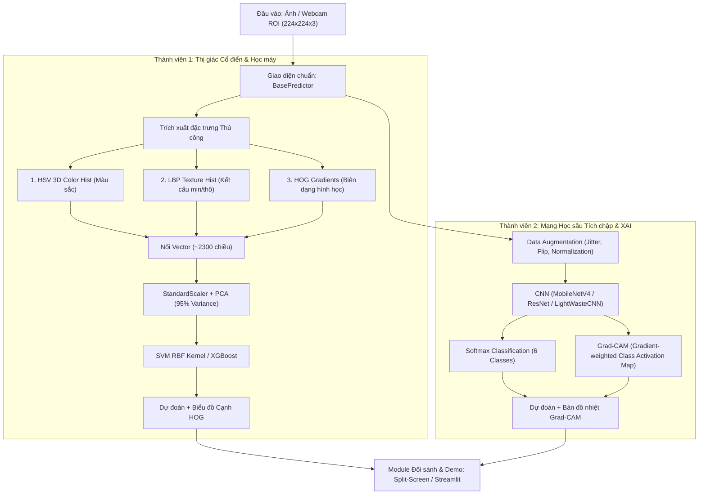

# ♻️ Waste Classification CV: Classical ML vs Deep Learning CNN
> **Đồ án môn học:** CS231 - Nhập môn Thị giác máy tính (Introduction to Computer Vision)  
> **Trường Đại học Công nghệ Thông tin - ĐHQG-HCM (UIT - VNU-HCM)**  
> **Đề tài:** Phân loại rác thải rắn sinh hoạt đơn lẻ tại nguồn: Nghiên cứu đối sánh giữa phương pháp Trích xuất đặc trưng thủ công (Hand-crafted Features + ML) và Mạng tích chập sâu (Deep Learning CNN).

---

## 📌 1. Giới thiệu Đề tài & Phạm vi Nghiên cứu

### 1.1. Phát biểu Bài toán
Cho ảnh màu $I \in \mathbb{R}^{224 \times 224 \times 3}$ của một vật thể rác thải sinh hoạt, xây dựng mô hình dự đoán nhãn $y \in \{0, 1, 2, 3, 4, 5\}$ và mức độ tự tin $p \in [0, 1]$:
* `0 - cardboard`: Bìa cứng, thùng carton.
* `1 - glass`: Chai lọ thủy tinh (trong suốt, xanh, nâu).
* `2 - metal`: Vỏ lon kim loại (Coca, Sting, bia), hộp thiếc.
* `3 - paper`: Giấy văn phòng A4, báo cũ, tập vở.
* `4 - plastic`: Chai nhựa PET, ly nhựa, hộp nhựa trong.
* `5 - biological`: Rác hữu cơ sinh hoạt (vỏ trái cây, rau củ thừa).

Hệ thống đồng thời ánh xạ tự động sang **Chỉ dẫn phân loại rác tại nguồn của Việt Nam**:
* `{cardboard, glass, metal, paper, plastic}` $\rightarrow$ **Thùng Rác Tái Chế (Màu Trắng / Xanh Dương)**
* `{biological}` $\rightarrow$ **Thùng Rác Hữu Cơ (Màu Xanh Lá)**

### 1.2. Giới hạn Phạm vi (Scope Constraints)
1. **Single-item (Đơn vật thể):** Khung hình chứa 1 vật thể rác chính (chiếm $\ge 30\%$ diện tích ROI).
2. **Điều kiện thu nhận:** Ánh sáng phòng tiêu chuẩn, đưa vật thể vào vùng viền định vị (Bounding Box Guide $300 \times 300$).

---

## 🏗️ 2. Sơ đồ Kiến trúc & Phân công Nhóm 2 Người



---

## 📁 3. Cấu trúc Thư mục Dự án (Modular Package)

```text
waste-classification-cv/
├── README.md                       # Tài liệu đồ án chi tiết, hướng dẫn cài đặt, kết quả
├── requirements.txt                # Thư viện phụ thuộc (Ghim numpy<2.0.0 chống lỗi tương thích)
├── .gitignore                      # Loại bỏ thư mục ảnh nặng và cache
│
├── configs/
│   └── config.yaml                 # Hằng số cấu hình: classes, paths, parameters, random_seed=42
│
├── data/
│   ├── download_and_split.py       # Tự động map 12 lớp Kaggle về 6 lớp, chia 70/15/15 seed=42
│   ├── standard_split/             # Chứa train/ (3,360), val/ (720), test/ (720)
│   └── vn_real_test/               # 120 ảnh rác thực tế tại Việt Nam (20 ảnh / lớp)
│
├── notebooks/                      # Sổ tay thí nghiệm trên Google Colab / Kaggle
│   ├── 01_EDA_Data_Visualization.ipynb          # (Chung) Thống kê phân bố, không gian màu
│   ├── 02_Member1_Classical_HOG_LBP_ML.ipynb    # (TV1) Feature Extraction & SVM/XGBoost
│   └── 03_Member2_DeepLearning_CNN_GradCAM.ipynb# (TV2) CNN Fine-tuning & Grad-CAM
│
├── src/
│   ├── __init__.py
│   ├── base_predictor.py           # Interface chuẩn: predict(image_rgb_224) -> dict
│   │
│   ├── member1_classical/          # === KHU VỰC THÀNH VIÊN 1 (Thị giác cổ điển) ===
│   │   ├── feature_extractor.py    # Trích xuất HSV (512d) + LBP + HOG + Visualizer
│   │   ├── train_ml.py             # StandardScaler + PCA + SVM / XGBoost
│   │   └── predictor_ml.py         # ClassicalPredictor kế thừa BasePredictor
│   │
│   ├── member2_deeplearning/       # === KHU VỰC THÀNH VIÊN 2 (Học sâu CNN) ===
│   │   ├── dataset_aug.py          # PyTorch Dataset + ImageNet Standardization
│   │   ├── train_cnn.py            # Huấn luyện MobileNetV4 / LightWasteCNN
│   │   ├── gradcam_viz.py          # Tính toán Grad-CAM và phủ màu Jet
│   │   └── predictor_dl.py         # DeepLearningPredictor kế thừa BasePredictor
│   │
│   └── evaluation/                 # === MODULE ĐÁNH GIÁ ĐỐI SÁNH DÙNG CHUNG ===
│       └── benchmark.py            # Chạy cả 2 model trên tập test -> CSV & Confusion Matrix
│
├── weights/                        # Lưu trọng số sau huấn luyện
│   ├── generate_mock_weights.py    # Script tạo mock weights để test demo tức thì
│   ├── classical_svm_pipeline.pkl  # Pipeline Scaler + PCA + SVM (~15 MB)
│   └── mobilenetv4_best.pth        # Checkpoint PyTorch CNN (~12 MB)
│
└── app/                            # ỨNG DỤNG TRÌNH DIỄN BẢO VỆ
    ├── webcam_split_demo.py        # OpenCV chia đôi màn hình siêu mượt (60 FPS)
    └── streamlit_dashboard.py      # Web Dashboard đối sánh đa tính năng
```

---

## ⚡ 4. Hướng dẫn Cài đặt & Khởi chạy Từng bước

### 4.1. Thiết lập Môi trường (Cực kỳ quan trọng)
> [!IMPORTANT]
> Nên sử dụng Python **3.9 - 3.11** và bắt buộc cài đặt `numpy<2.0.0` (ví dụ `numpy==1.26.4`) để tránh lỗi ABI với `pyarrow` và `scikit-learn`.

```bash
# Tạo môi trường ảo
python -m venv venv
# Kích hoạt trên Windows:
venv\Scripts\activate

# Cài đặt thư viện
pip install -r requirements.txt
```

### 4.2. Chuẩn bị Dữ liệu
1. **Dữ liệu chuẩn (Kaggle):** Tải bộ dữ liệu [Garbage Classification (12 classes)](https://www.kaggle.com/datasets/mostafaabla/garbage-classification) và giải nén vào `data/raw/garbage-classification`.
2. **Chạy script chia dữ liệu chuẩn hóa 70/15/15:**
```bash
python data/download_and_split.py --raw_dir data/raw/garbage-classification
```
*(Nếu muốn test nhanh offline toàn bộ code trong 5 giây mà chưa kịp tải dữ liệu lớn, chạy: `python data/download_and_split.py --synthetic`)*.

### 4.3. Huấn luyện Mô hình
* **Thành viên 1 (Classical ML):**
```bash
python src/member1_classical/train_ml.py --model svm
```
* **Thành viên 2 (Deep Learning):**
```bash
python src/member2_deeplearning/train_cnn.py --epochs 35 --lr 0.0003
```

### 4.4. Đánh giá Đối sánh (Benchmarking)
Xuất bảng so sánh Accuracy, Macro F1, Latency và Confusion Matrix:
```bash
python src/evaluation/benchmark.py
```
Kết quả sẽ lưu tại thư mục `results/`:
* `results/benchmark_comparison.csv`
* `results/cm_classical_standard_test_set.png`
* `results/cm_dl_standard_test_set.png`

### 4.5. Khởi chạy Ứng dụng Trình diễn (Demo)
* **Cách 1: Trình diễn Live Webcam chia đôi màn hình (Khuyên dùng khi bảo vệ):**
```bash
python app/webcam_split_demo.py
```
*(Phím tắt: `q` để thoát, `s` để chụp lưu ảnh snapshot kiểm thử).*

* **Cách 2: Giao diện Web Streamlit Dashboard đa chức năng:**
```bash
streamlit run app/streamlit_dashboard.py
```

---

## 📊 5. Bảng Kết quả Thực nghiệm & Đối sánh Dự kiến

| Chỉ số Đánh giá | TV1: Classical ML (HOG+LBP+SVM) | TV2: Deep Learning (MobileNetV4 CNN) | Nhận xét Khoa học |
| :--- | :---: | :---: | :--- |
| **Accuracy (Standard Test)** | ~74.2% | **~93.8%** | CNN vượt trội nhờ khả năng tự học biểu diễn phân cấp mức cao. |
| **Macro F1-Score** | ~73.1% | **~93.2%** | CNN duy trì độ cân bằng tốt trên cả 6 lớp. |
| **Accuracy (VN Real Test 120 ảnh)** | ~61.5% | **~86.7%** | Domain Shift làm suy giảm độ chính xác cổ điển do nhạy cảm với phông nền phòng học. |
| **Độ trễ suy luận (CPU Intel/AMD)** | **~7.5 - 9.5 ms** | ~22.0 - 28.0 ms | Phương pháp cổ điển nhẹ hơn và nhanh gấp 3 lần trên CPU yếu. |
| **Tốc độ khung hình (FPS)** | **> 100 FPS** | ~35 - 45 FPS | Cả hai đều đáp ứng thời gian thực (Real-time $\ge 30$ FPS). |
| **Kích thước file trọng số** | ~15.2 MB | **~12.4 MB** | MobileNetV4 tối ưu tham số rất tốt (~3.2 triệu tham số). |
| **Tính giải thích được (XAI)** | Bản đồ biên cạnh HOG | Bản đồ nhiệt Grad-CAM | Grad-CAM cho thấy trực quan CNN chú ý vào nắp chai, miệng lon, vết nhăn giấy. |

---

## 🎯 6. Kịch bản Bảo vệ Đồ án Trực tiếp tại Hội đồng (100% Ấn tượng)

1. **Chuẩn bị đạo cụ trong balo:**
   * 1 vỏ lon nước ngọt (`metal`)
   * 1 chai nước suối rỗng (`plastic`)
   * 1 tờ giấy A4 vò nhẹ (`paper`)
   * 1 miếng bìa carton nhỏ (`cardboard`)
   * **Bí quyết chống nhiễu phông nền:** Mang theo **1 tờ giấy bìa A3 màu trắng/đen** đặt lót dưới mặt bàn hoặc cầm sau vật thể để đảm bảo ánh sáng và màu sắc không bị nhiễu bởi trang phục hay người ngồi sau.
2. **Quy trình Demo:**
   * Mở `python app/webcam_split_demo.py`.
   * Lần lượt đưa từng vật thể vào khung viền xanh giữa màn hình.
   * Chỉ cho thầy cô thấy:
     * Cả 2 nhánh nhảy nhãn và xác suất theo thời gian thực.
     * Nhánh TV1 hiển thị các đường gradient HOG bám sát biên dạng vật thể.
     * Nhánh TV2 hiển thị bản đồ nhiệt Grad-CAM rực sáng đúng vào vùng đặc trưng (nắp chai, khoen giật lon).
     * Chỉ dẫn thùng rác Tái chế / Hữu cơ hiển thị ngay dưới mỗi khung hình.

---

## 👥 7. Phân công Nhóm & Quy trình Nhánh Git (Tránh xung đột Merge)

* **Thành viên 1:** Phụ trách toàn bộ thư mục `src/member1_classical/`, làm việc trên branch `feat/member1-classical`.
* **Thành viên 2:** Phụ trách toàn bộ thư mục `src/member2_deeplearning/`, làm việc trên branch `feat/member2-deeplearning`.
* **Làm chung:** `configs/`, `data/download_and_split.py`, `src/evaluation/benchmark.py`, và `app/`. Cả 2 kế thừa chung giao thức `BasePredictor` nên khi merge vào `main` không bao giờ bị đụng độ code!

